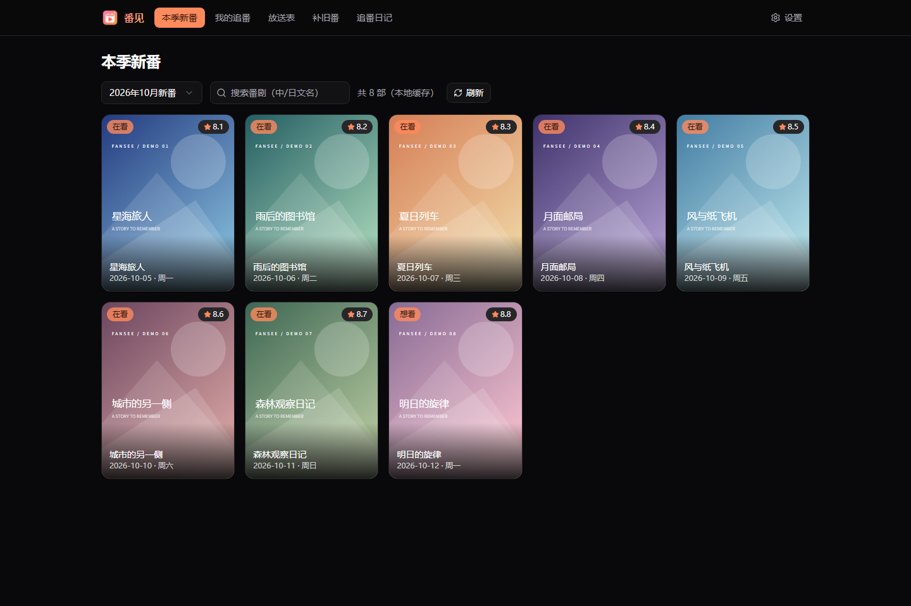
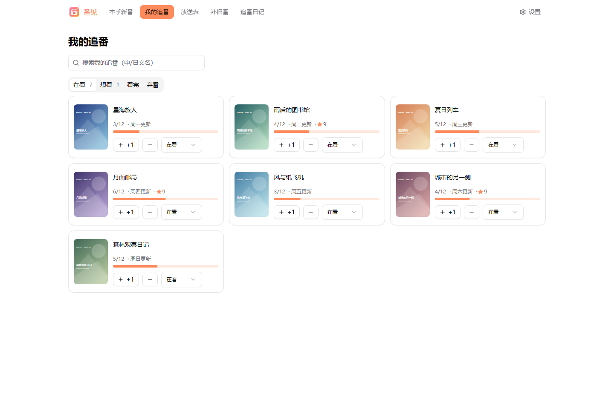
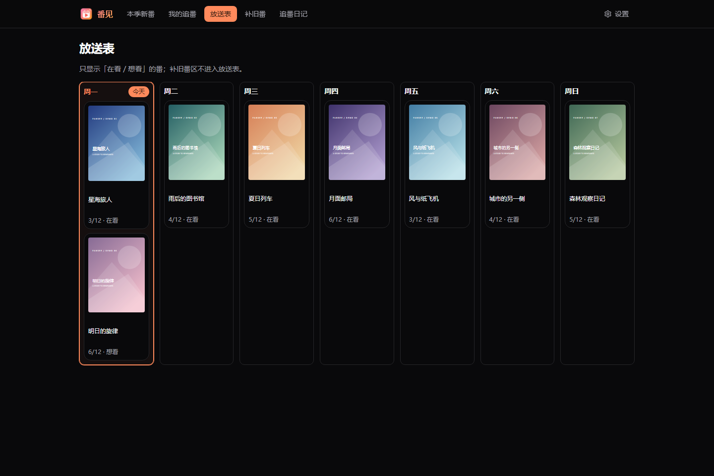
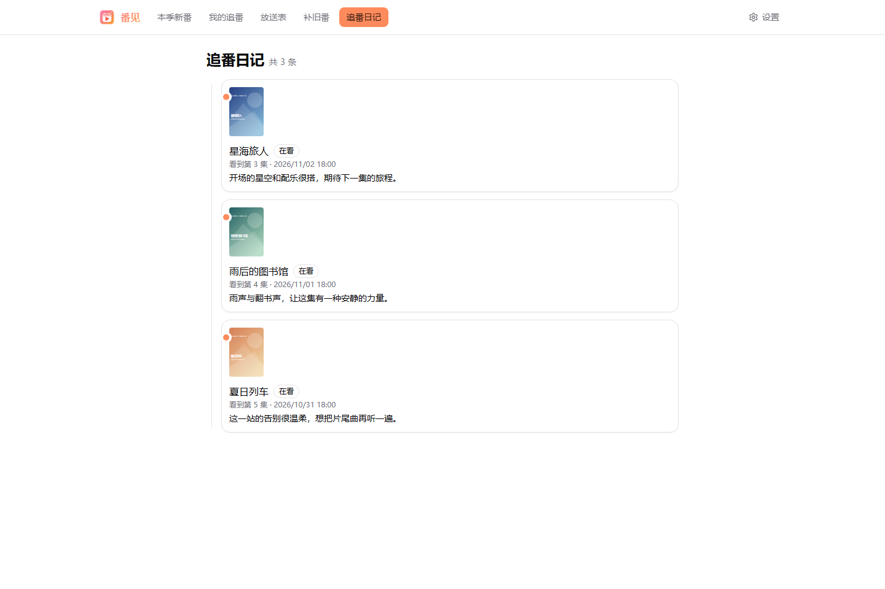
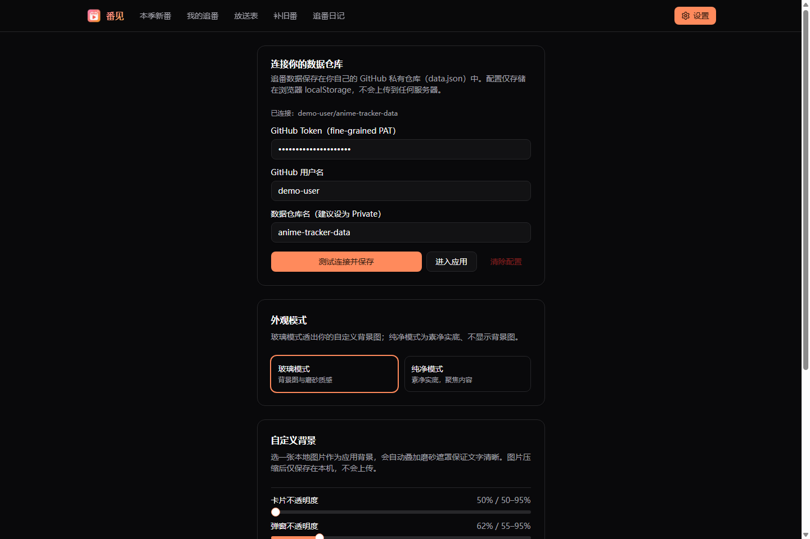

<div align="center">


# Fansee · 番见

**Your seasonal watchlist, episode progress, and thoughts—all in one place.**

Open-source personal anime tracker · Windows / macOS desktop · Web · Private GitHub storage

[简体中文](README.md) | [English](README.en.md)

[Download](https://github.com/Misaka-NO1/anime-tracker/releases/latest) · [Setup guide](#first-time-setup) · [Run locally](#local-development) · [Report an issue](https://github.com/Misaka-NO1/anime-tracker/issues)


</div>

**Contents:** [Features](#features) · [Installation](#installation) · [Setup](#first-time-setup) · [Everyday use](#everyday-use) · [Troubleshooting](#troubleshooting) · [Development](#local-development) · [Deployment](#deploying-the-web-version)

## About

Fansee (番见, formerly 追番日程表; repository name: `anime-tracker`) brings seasonal discovery, viewing progress, weekly schedules, and personal reactions into one application. Pick a few shows, tap `+1` after each episode, and leave a note while the moment is still fresh.

Anime metadata comes from [Bangumi](https://bgm.tv). Your personal records are saved through the GitHub API to **your own private repository**. The Web app is a static frontend, packaged with Electron for desktop, so you do not need to operate a backend or database. Network access to GitHub, Bangumi, and related services is still required.

> Fansee manages viewing records; it does not stream or download anime or aggregate video sources. The application interface is currently primarily Simplified Chinese. This repository provides Chinese and English documentation.

## Screenshots

These are actual Web UI captures rendered from the current code, using fictional titles, illustrative covers, and sample records. They do not represent real anime metadata. Desktop title bars and native material effects vary by platform.

### Seasonal discovery



### Your watchlist



<details>
<summary>More screenshots: weekly schedule, diary, and settings</summary>

**Weekly schedule** — Monday through Sunday, with today highlighted.



**Watch diary** — Revisit reactions with their timestamps and episode numbers.



**Settings** — Connect your repository and customize appearance.



</details>

## Features

| Feature | What it does |
| --- | --- |
| Seasonal discovery | Switch quarters; browse posters, titles, premiere dates and Bangumi ratings; filter the current list by Chinese or Japanese title |
| Watchlist | Manage Want to watch / Watching / Completed / Dropped; search tracked shows; increment progress or undo with `−1` |
| Show details | Read summaries, tags and airing information; give a personal 1–10 rating; save multiple reactions |
| Weekly schedule | Organize tracked Watching / Want to watch shows by weekday and highlight today |
| Backlog | Search Bangumi for older shows or manually enter a title, episode count and note; track progress separately |
| Watch diary | Combine reactions into a reverse chronological timeline with the episode number at the time of writing |
| Appearance | Glass / solid modes, a local background image, overlay and card / dialog opacity; system light and dark themes |
| Personal storage | Save to `data.json` in a private GitHub repository; load remote records on startup; detect save conflicts |
| Desktop updates | Background downloads on Windows; release checks and a download-page link on macOS |

## Installation

### Option A: Desktop app (recommended for everyday use)

Open [Latest release](https://github.com/Misaka-NO1/anime-tracker/releases/latest), expand **Assets**, and select a file available for your system:

| System | File | Installation |
| --- | --- | --- |
| Windows | `anime-tracker-<version>-win.exe` | Run the installer, then launch 番见 |
| macOS | `anime-tracker-<version>-mac.dmg` | Open the image and drag the app to Applications |
| macOS | `anime-tracker-<version>-mac.zip` | Extract and move the app to Applications |

Available files depend on the release. **Source code** archives are not desktop installers. There is currently no Linux desktop packaging script; Linux users can run the Web version below.

Current macOS builds are unsigned. If the system blocks launch, verify the download source and follow the instructions in Privacy & Security. For Windows source warnings, first confirm that the installer came from this repository's official release page.

After installation, complete the GitHub storage setup below. The desktop app also needs a network connection for synchronization.

### Option B: Web browser

[Run the source locally](#local-development) or [deploy a static site](#deploying-the-web-version). Each browser, browser profile, and desktop installation keeps its own connection settings; configure each to use the same data repository.

## First-time setup

**You need:** a GitHub account and a network connection that can reach the GitHub API. You do not need to edit source code or obtain a Bangumi token.

### 1. Create a private data repository

1. Sign in to GitHub and open [Create a repository](https://github.com/new).
2. Select your account under **Owner**.
3. Set **Repository name** to `anime-tracker-data`, or another name you prefer.
4. Select **Private**.
5. Leave the repository empty if you wish. You do not need to create `data.json` manually. Click **Create repository**.
6. Keep the repository address, for example `https://github.com/your-name/anime-tracker-data`.

This is **your personal data repository**, separate from the public application source repository. Desktop users do not need to fork the application.

### 2. Create a narrowly scoped token

1. Open [Fine-grained personal access tokens](https://github.com/settings/personal-access-tokens) and choose **Generate new token**.
2. Give it a recognizable **Token name**, such as `Fansee`, and choose an **Expiration**. You will need to replace it when it expires.
3. Under **Resource owner**, select the account that owns your data repository.
4. Under **Repository access**, choose **Only select repositories** and select only `anime-tracker-data`.
5. Under repository permissions, set **Contents** to **Read and write**. Keep GitHub's automatically included read-only Metadata permission; no additional permissions are needed.
6. Choose **Generate token** and copy the full value for the next step. The full token is normally displayed only once.

Refer to [GitHub's token documentation](https://docs.github.com/en/authentication/keeping-your-account-and-data-secure/managing-your-personal-access-tokens) if the form changes. Organization-owned repositories may require administrator approval.

### 3. Connect Fansee

On first launch, Fansee opens Settings (设置). Enter:

| UI field | Value | Notes |
| --- | --- | --- |
| GitHub Token | The complete token you just generated | This is not your GitHub password |
| GitHub 用户名 | `your-name` | Repository owner's account name, not the display name |
| 数据仓库名 | `anime-tracker-data` | Repository name only; no URL or `.git` suffix |

Click **测试连接并保存** (Test connection and save). Successful setup opens Seasonal discovery. A message that `data.json` does not exist is expected: the first saved change creates it automatically.

> The connection test checks repository and file reads; it does not perform a test write. After your first change, also verify that the header does not say 保存失败 (Save failed) and that `data.json` appears in your data repository.

### 4. Record your first episode

1. Open **本季新番** (Seasonal discovery), choose a quarter, and optionally filter the list by title.
2. Hover over a poster and click **追这部** (Track this show). The show is added as 想看 (Want to watch). The card button is also usable on touch devices.
3. Open **我的追番** (My watchlist) → **想看** and change the show to **在看** (Watching).
4. Click `+1` after an episode, or `−1` to undo. Reaching a known total prompts you to mark the show as completed.
5. Click its cover or title to open details. Set a personal rating and submit a reaction; each reaction records your current episode progress.
6. Use **放送表** (Weekly schedule) for the week ahead and **追番日记** (Watch diary) to revisit your notes.

## Everyday use

### Seasonal shows, backlog, and schedules

- Add current-season shows from **本季新番**; they appear in **我的追番**.
- Use **补旧番** (Backlog) for older shows. Search Bangumi to bring in covers and episode counts, or enter them manually.
- Backlog records are maintained separately. They do not appear in the weekly schedule or provide the same reaction timeline as tracked shows.
- The schedule includes only tracked **在看 / 想看** (Watching / Want to watch) shows with a known airing weekday. Completed and dropped shows are excluded.
- Weekdays come from stored metadata, or may be inferred from the premiere date. This is not a live streaming-platform release schedule.
- `?` means the total episode count is unknown or incomplete. Opening details may fill in missing metadata.

### Switching devices

Install the app or open the Web version on the other device. Enter a token authorized for **the same data repository**, along with its owner and name. You can create a separate narrowly scoped token for each device.

Fansee reads remote data when a configured app starts and saves changes automatically. It does not provide live collaboration or periodic polling. Reopen or refresh before editing after switching devices. Avoid simultaneous edits: a save conflict reloads the remote version and displays a notice; an unsaved change may need to be entered again.

### Appearance

Open **设置** (Settings) to choose **玻璃模式** (Glass) or **纯净模式** (Solid). Glass mode supports a local background image, overlay strength, and card / dialog opacity. Solid mode uses an opaque background. Background images are compressed and stored only on that device; appearance preferences are not synchronized through GitHub. Light and dark themes follow the system setting.

### Saving, backups, and privacy

- Personal records live in `data.json` at the root of your private repository: progress, statuses, ratings, reactions, and metadata snapshots. Successful saves create Git commits for history.
- Download `data.json` from GitHub for a backup. There is currently no in-app import / export button. Before restoring an older version, back up the current file, restore the desired content through GitHub, then reopen the app.
- The token and repository settings are stored in browser / Electron `localStorage`, rather than an encrypted system keychain. The token is sent to GitHub for authentication; it is not written into the tracking `data.json`. Clearing local configuration neither deletes remote records nor revokes the token.
- Keep tokens out of screenshots, issues, source files, and public repositories. Revoke a token on GitHub when it is no longer needed.
- **Do not rely on offline persistence.** Failed saves retain edits only in the current page's memory and retry on a subsequent operation. Refreshing or closing may lose unsynchronized edits. Restore connectivity and verify a successful save before leaving.

## Troubleshooting

| Problem | What to check |
| --- | --- |
| Redirected to Settings | Finish Test connection and save in this browser or installation |
| `401` / invalid token | Check for an incomplete, expired, or revoked token; generate a replacement and update Settings |
| `403` / access denied | Check repository selection, Contents read/write access, organization approval and policies; API rate limits can also cause errors |
| `404` / repository not found | Check owner, repository name, and token authorization; inaccessible private repositories may also return 404 |
| Connection test passes but saves fail | The test does not verify write access; check Contents read/write permission, network access, and repository restrictions |
| Slow seasonal loading or missing covers / ratings | First load uses paginated API requests; cached or bangumi-data fallback entries may contain less metadata. Try refreshing later |
| Missing show in schedule | It must be tracked, Want to watch / Watching, and have a known weekday; backlog records are excluded |
| Another device has old progress | Verify a successful save on the first device, confirm the same repository, then reopen or refresh the other device |
| Update check fails | Check access to GitHub Releases or download a new installer manually; update delivery is separate from your data repository |

## Local development

Run these commands in the **repository root**, which contains `package.json`.

### Requirements and startup

Use Node.js **22.12+**, or a newer LTS satisfying the [Vite requirements](https://vite.dev/guide/), plus npm and Git.

```bash
git clone https://github.com/Misaka-NO1/anime-tracker.git
cd anime-tracker
npm ci
npm run dev
```

Open the address printed in the terminal, normally `http://localhost:3000`. If that port is busy, use the actual printed address. Complete the same data repository setup on first launch. Stop the development server with `Ctrl+C`.

| Command | Purpose |
| --- | --- |
| `npm run dev` | Start the Vite development server |
| `npm run build` | Type-check and build into `dist/` |
| `npm run preview` | Preview the production build locally; run build first |
| `npm run lint` | Run ESLint |
| `npx electron .` | Launch the local desktop app after building; updates are skipped when unpackaged |
| `npm run dist:win` | Build a Windows NSIS installer into `release/` |
| `npm run dist:mac` | Build macOS packages into `release/`; building on macOS is recommended |

### Bangumi networking and the development proxy

The app first tries `https://api.bgm.tv` directly. In HTTP(S) environments, it can also try `/bgm-api`. The Vite development server forwards that path through an outbound HTTP proxy, defaulting to `http://127.0.0.1:7890`. Override it with `BGM_PROXY` or lowercase `https_proxy`.

PowerShell example; replace the port with your own HTTP proxy port:

```powershell
$env:BGM_PROXY = 'http://127.0.0.1:7890'
npm run dev
```

macOS / Linux:

```bash
BGM_PROXY=http://127.0.0.1:7890 npm run dev
```

This is needed only when direct access fails and you need the development fallback. Forwarding can fail if no proxy listens at that address. This setting applies to the Vite development server; it does not add a proxy service to desktop installers or static deployments.

## Deploying the Web version

Vite uses `base: './'`, and routing uses `HashRouter`, supporting GitHub Pages subpaths and other static hosts.

**Manual GitHub Pages deployment:**

1. Fork this project, clone your fork, and run `npm ci`.
2. Run `npm run build`.
3. Run `npx gh-pages -d dist`. Accept installation of the publishing tool if prompted, and use a Git identity with write access. By default, this publishes to the current repository's `gh-pages` branch.
4. In **Settings → Pages → Build and deployment**, select **Deploy from a branch**, choose `gh-pages` and `/ (root)`, then save.
5. Wait for Pages to provide the site URL, open it, and connect your separate **private data repository**.

This repository does not include a Pages automation workflow. Upload only the contents of `dist/`; never bundle a token or personal `data.json`. Static hosting and `vite preview` do not automatically provide the development `/bgm-api` forwarder. They require direct Bangumi connectivity or a separately configured service.

Refer to [GitHub's publishing-source guide](https://docs.github.com/en/pages/getting-started-with-github-pages/configuring-a-publishing-source-for-your-github-pages-site) for the current Pages settings.

## Technology and structure

**React 19 + TypeScript + Vite 7**, with Tailwind CSS, shadcn/ui, Zustand and React Router (HashRouter). Desktop packaging uses Electron and electron-builder.

```text
.
├── electron/             # Window, preload bridge, updater
├── src/
│   ├── pages/            # Discovery, watchlist, schedule, backlog, diary, settings
│   ├── components/       # Details dialog, layout, shared UI
│   ├── lib/              # Bangumi / GitHub APIs, seasons, backgrounds
│   ├── store/            # State, save queue, conflict handling
│   └── types/            # Personal data and API types
├── docs/screenshots/     # README screenshots
├── public/               # Static resources
├── package.json          # Commands and packaging configuration
└── vite.config.ts        # Aliases, development server, proxy
```

Seasonal lists use a 24-hour local cache. Stale cached data can display immediately while refreshing in the background; failed requests fall back to older cache or [bangumi-data](https://github.com/bangumi-data/bangumi-data). Personal data uses the GitHub REST Contents API with a file SHA for updates. Conflicts reload the remote data rather than merging automatically.

See [`src/types/index.ts`](src/types/index.ts) for the data types. An empty data file looks like:

```json
{
  "version": 1,
  "updatedAt": "2026-11-02T10:00:00.000Z",
  "tracking": [],
  "backlog": []
}
```

`version` denotes the data schema, not the application version. `tracking` holds statuses, progress, ratings, reaction timelines and metadata snapshots; `backlog` holds separate backlog records.

## Updates and release maintenance

Packaged Windows builds check and download updates in the background after launch. When ready, choose Restart and install; downloaded updates are also set to install on quit. Current macOS builds check the version and link to Releases for manual download. Settings offers a manual update check. Update the Web app by redeploying it.

For maintainers:

1. Update the version in `package.json` and synchronize `package-lock.json`.
2. Build on the relevant platform and verify launch behavior, installers, and update manifests.
3. Upload using the GitHub publishing configuration in `package.json` and a `GH_TOKEN` with write access to the **application release repository**. This serves a different purpose from a user's personal data token.
4. The current `npm run release` requests Windows and macOS builds and publication. Cross-platform builds depend on the toolchain; prefer building on each target system and uploading to the same versioned release.
5. Inspect the release status and assets created by electron-builder; publish the draft if needed. Windows updates require the installer and accompanying files such as `latest.yml`; retain the update artifacts generated by the builder.

Never commit publishing credentials. macOS signing / notarization requires separate configuration; packaging alone does not provide it.

## Feedback and contributions

[Issues](https://github.com/Misaka-NO1/anime-tracker/issues) and pull requests are welcome. Include your OS, app version, reproduction steps, and screenshots with private information removed. Never attach tokens or complete private records. Run the build and checks relevant to a code change before submitting it.

Thanks to [Bangumi](https://bgm.tv), [bangumi-data](https://github.com/bangumi-data/bangumi-data), and the open-source projects used by Fansee.

## License

[MIT](LICENSE)
