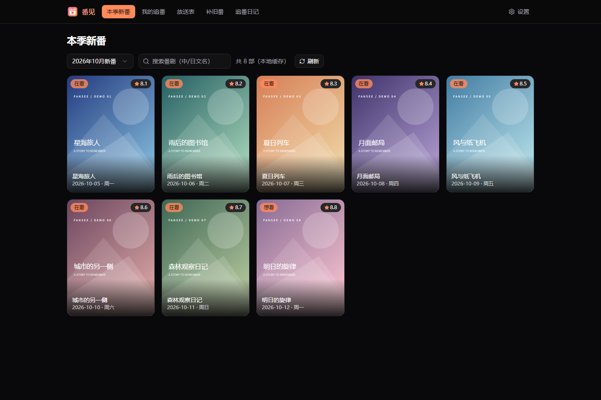
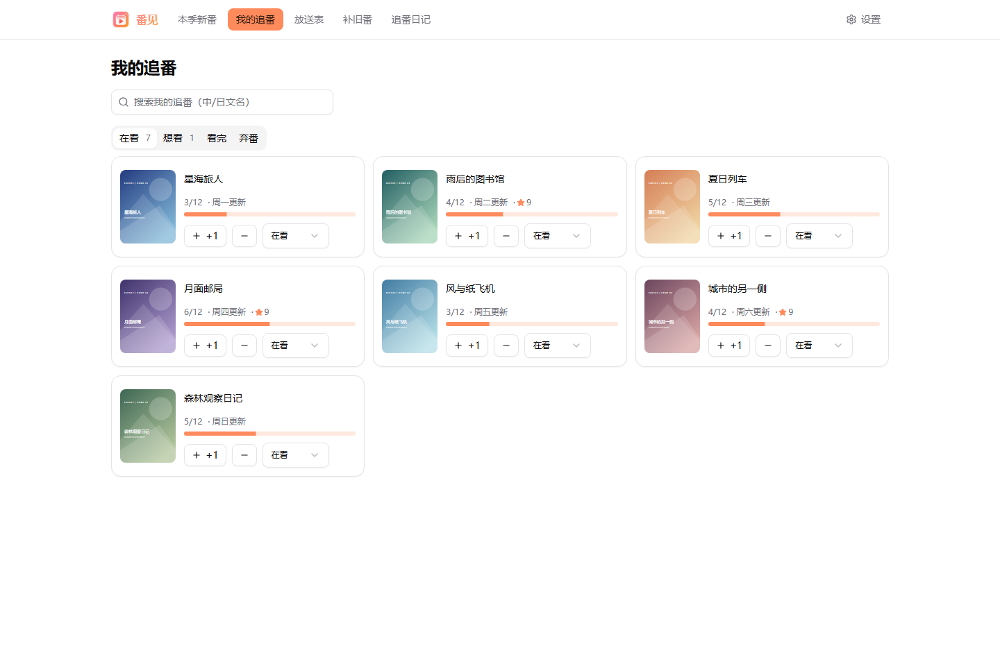
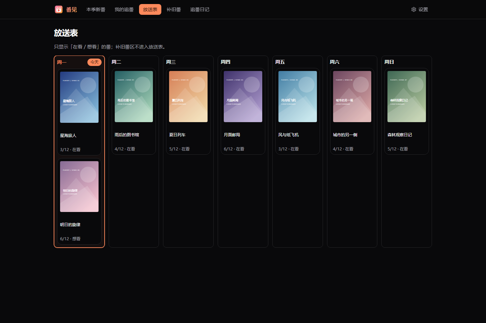
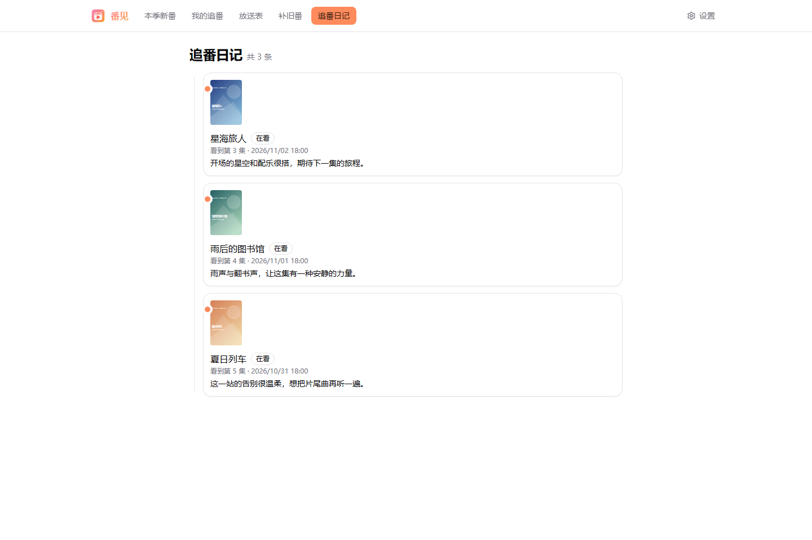
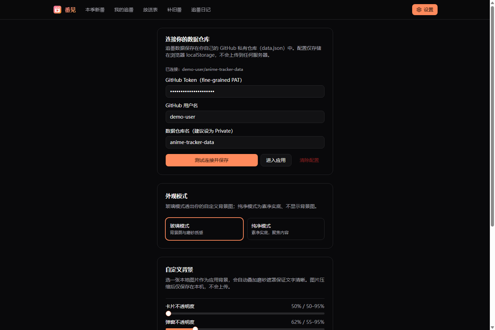

<div align="center">


# 番见 · Fansee

**把每一季的期待，和每一集的感想，收进自己的追番日程表。**

开源个人追番管理工具 · Windows / macOS 桌面端 · Web 端 · GitHub 私有仓库同步

[简体中文](README.md) | [English](README.en.md)

[下载安装](https://github.com/Misaka-NO1/anime-tracker/releases/latest) · [使用教程](#首次配置一步一步来) · [本地运行](#本地运行与开发) · [反馈问题](https://github.com/Misaka-NO1/anime-tracker/issues)


</div>

**导航：** [功能](#功能一览) · [安装](#安装与选择版本) · [首次配置](#首次配置一步一步来) · [日常使用](#日常使用教程) · [常见问题](#常见问题) · [开发](#本地运行与开发) · [部署](#部署-web-版本)

## 这是什么？

番见（原「追番日程表」，仓库名 `anime-tracker`）是一款把新番发现、观看进度、每周放送和观后感放在一起的个人工具。你可以先挑选这一季想看的作品，看完一集点一下 `+1`，再随手写下当时的感想。

番剧信息来自 [Bangumi](https://bgm.tv)，个人记录通过 GitHub API 保存到**你自己的私有数据仓库**。网页端是静态前端，桌面端用 Electron 打包，无需自建业务后端或数据库。使用时仍需网络访问 Bangumi、GitHub 等服务。

> 番见用于管理观看记录，不提供视频播放、番剧下载或片源聚合。当前应用界面以简体中文为主；本项目提供中英双语文档。

## 界面预览

以下是当前代码渲染的实际 Web 界面截图，使用虚构番名、示意封面和演示记录，不代表真实番剧信息；桌面端的系统标题栏和材质效果因平台而异。

### 本季新番：先挑好这一季想看的作品



### 我的追番：状态、进度与个人评分



<details>
<summary>查看更多：每周放送表、追番日记与设置</summary>

**每周放送表**：周一至周日排列，突出今天。



**追番日记**：按时间回看当时的感想和观看集数。



**设置**：连接自己的仓库，调整外观与背景。



</details>

## 功能一览

| 功能 | 可以做什么 |
| --- | --- |
| 本季新番 | 切换季度，浏览海报、番名、首播日期和 Bangumi 评分；按中/日文名筛选当前列表 |
| 我的追番 | 按「想看 / 在看 / 看完 / 弃番」管理；搜索已追作品；`+1` 记进度、`−1` 撤回误点 |
| 作品详情 | 查看简介、标签、放送信息；维护个人 1–10 分评分；记录多条感想 |
| 每周放送表 | 仅展示「想看 / 在看」作品，按放送星期排列，今天高亮 |
| 补旧番 | 从 Bangumi 搜索添加，或手动录入番名、总集数及备注；独立管理进度 |
| 追番日记 | 汇总追番感想，按时间倒序排列，并保留记录时的集数 |
| 外观设置 | 玻璃 / 纯净模式、本地背景图、遮罩与卡片 / 弹窗不透明度；适配系统明暗主题 |
| 数据同步 | 通过私有仓库 `data.json` 保存记录；重新打开应用时读取远端；保存有冲突检测 |
| 桌面更新 | Windows 后台下载更新；macOS 检查版本后前往 Releases 下载 |

## 安装与选择版本

### 方式一：桌面端（普通用户推荐）

打开 [最新 Releases](https://github.com/Misaka-NO1/anime-tracker/releases/latest)，展开 **Assets**，按系统选择实际提供的文件：

| 系统 | 文件类型 | 安装方式 |
| --- | --- | --- |
| Windows | `anime-tracker-<版本>-win.exe` | 下载后运行安装程序，完成后打开「番见」 |
| macOS | `anime-tracker-<版本>-mac.dmg` | 打开镜像，将应用拖到「应用程序」后启动 |
| macOS | `anime-tracker-<版本>-mac.zip` | 解压后将应用移入「应用程序」使用 |

以发布页实际 Assets 为准，源码压缩包 **Source code** 不是桌面安装包。项目目前未提供 Linux 桌面打包脚本，Linux 可采用下方 Web 运行方式。

当前 macOS 构建未签名；如系统阻止启动，先核对下载来源，再按系统「隐私与安全性」中的提示操作。Windows 若出现来源提示，也应先确认文件来自本仓库官方发布页。

安装后还需要完成下面的 GitHub 数据仓库配置；桌面端同样需要联网同步。

### 方式二：浏览器运行

可[从源码本地启动](#本地运行与开发)，也可[部署成静态网站](#部署-web-版本)。每个浏览器、浏览器配置文件或桌面端都有独立的本地配置，需要分别连接同一个数据仓库。

## 首次配置：一步一步来

**准备：** 一个 GitHub 账号，以及可以访问 GitHub API 的网络。你不需要修改项目代码，也不需要申请 Bangumi Token。

### 1. 创建专门保存记录的私有仓库

1. 登录 GitHub，打开 [新建仓库](https://github.com/new)。
2. **Owner** 选择自己的账号。
3. **Repository name** 填 `anime-tracker-data`（也可以用其他名字）。
4. 可见性选择 **Private**。
5. 可以保持空仓库；不必手动创建 `data.json`。点击 **Create repository**。
6. 记住仓库地址，例如 `https://github.com/your-name/anime-tracker-data`。

这里创建的是**你自己的数据仓库**，不是本项目公开的源码仓库。不需要 Fork 本项目才能使用桌面端。

### 2. 创建仅允许访问数据仓库的 Token

1. 打开 [Fine-grained personal access tokens](https://github.com/settings/personal-access-tokens)，选择 **Generate new token**。
2. **Token name** 填一个方便识别的名字，如 `Fansee`；选择合适的 **Expiration**，到期后需要更换。
3. **Resource owner** 选择刚才创建数据仓库的账号。
4. **Repository access** 选择 **Only select repositories**，只勾选 `anime-tracker-data`。
5. 在仓库权限中，将 **Contents** 设置为 **Read and write**。保留 GitHub 自动附带的 Metadata 只读权限，其他权限无需添加。
6. 点击 **Generate token**，复制生成的 Token，下一步粘贴到应用中。完整 Token 通常只展示这一次。

权限表单如有调整，可参照 [GitHub 官方 Token 文档](https://docs.github.com/en/authentication/keeping-your-account-and-data-secure/managing-your-personal-access-tokens)。如果选择组织仓库，还可能需要组织管理员批准。

### 3. 在番见中连接仓库

首次打开会进入「设置」，填写：

| 应用字段 | 填写示例 | 注意 |
| --- | --- | --- |
| GitHub Token | 粘贴上一步生成的完整 Token | 不是 GitHub 登录密码 |
| GitHub 用户名 | `your-name` | 仓库所有者的账号名，不是个人显示昵称 |
| 数据仓库名 | `anime-tracker-data` | 只填名称，不填完整 URL 或 `.git` 后缀 |

点击 **测试连接并保存**。成功后会进入「本季新番」。提示 `data.json 尚不存在` 是正常的：首次添加或修改记录时会自动创建它。

> 连接测试会检查仓库和文件的读取情况，不会试写数据。因此首次实际保存后，也请确认顶栏没有「保存失败」，并到数据仓库查看是否出现 `data.json`。

### 4. 做一次完整的追番记录

1. 在「本季新番」选择季度，输入番名可以筛选当前季度列表。
2. 将鼠标移到海报卡片上，点击 **追这部**，作品会以「想看」状态加入列表；触屏也可操作卡片上的按钮。
3. 打开「我的追番」→「想看」，将该作品改为 **在看**。
4. 看完一集点 `+1`，点错可用 `−1` 回退。到达已知总集数时，应用会询问是否标记为「看完」。
5. 点击封面或标题进入详情，设置个人评分，输入感想并提交。感想会记住当时的集数。
6. 在「放送表」查看本周安排，在「追番日记」回顾记录。

## 日常使用教程

### 新番、补旧番和放送表如何配合？

- **当季追番**从「本季新番」添加，统一进入「我的追番」。
- **旧作品**可进入「补旧番」，用 Bangumi 搜索自动带入封面与集数，也可手动填写。
- 补旧番列表独立维护，不进入放送表，也不等同于追番详情里的感想时间线。
- 放送表只展示「在看 / 想看」且有放送星期的追番；「看完 / 弃番」不会出现。
- 放送星期优先使用已保存的元数据，缺失时可能由首播日期推算；它不是各视频平台的实时上架时间表。
- 总集数为 `?` 表示未知或资料不完整；打开作品详情有机会补齐元数据。

### 如何换设备？

在另一台设备安装应用（或打开 Web 端），重新填写能访问**同一个数据仓库**的 Token、Owner 和仓库名。可以为每台设备分别创建最小权限 Token。

应用在已配置后启动时读取远端，修改时自动提交保存。它没有实时协同或定时拉取机制：从另一台设备切回来时，建议重新打开或刷新，再继续记录。尽量避免两台设备同时修改；冲突时应用会采用远端数据并提示，未成功保存的本次修改可能需要重新操作。

### 如何更换外观？

进入「设置」切换 **玻璃模式 / 纯净模式**。玻璃模式可选择本地背景图并调整遮罩、卡片和弹窗不透明度；纯净模式使用实底。背景图片压缩后只保存在当前设备，外观偏好不会通过数据仓库同步。明暗主题跟随系统设置。

### 保存、备份与隐私

- 追番记录保存在私有仓库根目录 `data.json`，包括进度、状态、评分、感想及元数据快照；正常保存会产生 Git commit，方便查看历史。
- 可在 GitHub 下载 `data.json` 留存备份；目前没有应用内导入 / 导出按钮。恢复历史前先备份当前文件，再在 GitHub 还原需要的内容，最后重新打开应用。
- Token、仓库连接信息保存在当前浏览器 / Electron 的 `localStorage`，并非系统钥匙串加密存储。Token 会随请求发送给 GitHub 用于认证，不会写入追番 `data.json`。清除配置不会删除远端记录，也不会吊销 Token。
- 不要把 Token 放入截图、Issue、源码或公开仓库；需要停用时，到 GitHub 吊销它。
- **不要把应用当作离线记录工具。** 保存失败时修改只保留在当前页面内存中，下次操作会尝试保存；刷新或关闭可能丢失尚未同步的修改。先恢复网络，确认保存成功再退出。

## 常见问题

| 问题 | 排查方法 |
| --- | --- |
| 一直跳回设置 | 当前环境还没有成功保存连接配置；先完成「测试连接并保存」 |
| `401` / Token 无效 | 检查是否复制完整、已到期或被吊销；重新生成后在设置中替换 |
| `403` / 无权限 | 确认 Token 授予数据仓库 Contents 读写权限；如为组织仓库，检查审批和组织策略；也可能遇到接口限流 |
| `404` / 找不到仓库 | 核对 Owner、仓库名及 Token 的仓库授权；私有仓库无权限时也可能返回 404 |
| 连接成功但保存失败 | 测试连接不验证写入权限；再次检查 Contents 是否为 Read and write、网络和仓库限制 |
| 新番加载慢或没有封面 / 评分 | 首次加载需分页请求；API 不可用时会尝试缓存和 bangumi-data 兜底，兜底信息可能不完整。可稍后点刷新 |
| 放送表没有某作品 | 确认它是追番记录、状态为想看 / 在看，而且有已知放送星期；补旧番不在这里显示 |
| 另一台设备没有新进度 | 先确认原设备保存成功、两端连接相同仓库，再重新打开或刷新目标设备 |
| 更新检查失败 | 检查访问 GitHub Releases 的网络；也可直接下载对应系统的新安装包。数据仓库与更新下载相互独立 |

## 本地运行与开发

以下命令均在**仓库根目录**执行（即包含 `package.json` 的目录）。

### 环境与启动

建议使用 Node.js **22.12+** 或满足 [Vite 环境要求](https://vite.dev/guide/)的更新 LTS 版本，以及 npm、Git。

```bash
git clone https://github.com/Misaka-NO1/anime-tracker.git
cd anime-tracker
npm ci
npm run dev
```

打开终端输出的本地地址，默认是 `http://localhost:3000`；若端口被占用，以实际输出为准。首次仍需按上面的步骤连接数据仓库。停止开发服务可在终端按 `Ctrl+C`。

| 命令 | 用途 |
| --- | --- |
| `npm run dev` | 启动 Vite 开发服务器 |
| `npm run build` | TypeScript 检查并构建到 `dist/` |
| `npm run preview` | 本地预览生产构建（先运行 build） |
| `npm run lint` | ESLint 代码检查 |
| `npx electron .` | 构建后启动本地桌面端；未打包时跳过自动更新 |
| `npm run dist:win` | 构建 Windows NSIS 安装包，输出至 `release/` |
| `npm run dist:mac` | 构建 macOS 包，输出至 `release/`；建议在 macOS 上构建 |

### Bangumi 网络与开发代理

应用优先直连 `https://api.bgm.tv`，HTTP(S) 环境下还会尝试 `/bgm-api`。开发服务器已为这个路径配置转发，出站代理默认是 `http://127.0.0.1:7890`，可通过 `BGM_PROXY` 或小写 `https_proxy` 环境变量覆盖。

PowerShell 示例（端口换成自己的 HTTP 代理端口）：

```powershell
$env:BGM_PROXY = 'http://127.0.0.1:7890'
npm run dev
```

macOS / Linux：

```bash
BGM_PROXY=http://127.0.0.1:7890 npm run dev
```

只有直连失败、需要使用开发代理时才需要此配置。本地没有对应代理时，开发转发可能失败。该设置仅作用于 Vite 开发服务，不会给桌面安装包或静态站点增加代理服务器。

## 部署 Web 版本

Vite 已配置 `base: './'`，路由使用 `HashRouter`，适合 GitHub Pages 子路径或其他静态托管。

**GitHub Pages 手动部署示例：**

1. Fork 本项目并克隆自己的 Fork，运行 `npm ci`。
2. 运行 `npm run build`。
3. 运行 `npx gh-pages -d dist`，按提示安装该发布工具并使用有仓库写入权限的 Git 身份推送；默认发布到当前仓库的 `gh-pages` 分支。
4. 在 GitHub 仓库 **Settings → Pages → Build and deployment**，选择 **Deploy from a branch**，分支选 `gh-pages`、目录选 `/ (root)`，保存。
5. 等待 Pages 给出网站地址，再打开并连接自己的**私有数据仓库**。

本仓库未附带 Pages 自动部署工作流。发布站点只需要上传 `dist/` 内容，不要把 Token 或个人 `data.json` 打进网站产物。静态托管和 `vite preview` 不会自动获得开发用 `/bgm-api` 转发；需要能直连 Bangumi，或自行配置相应服务。

Pages 配置入口以 [GitHub 官方发布源说明](https://docs.github.com/en/pages/getting-started-with-github-pages/configuring-a-publishing-source-for-your-github-pages-site)为准。

## 技术与目录

**React 19 + TypeScript + Vite 7**，搭配 Tailwind CSS、shadcn/ui、Zustand、React Router（HashRouter）；桌面端使用 Electron 和 electron-builder。

```text
.
├── electron/             # 桌面窗口、预加载桥接、更新逻辑
├── src/
│   ├── pages/            # 新番、追番、放送、补番、日记、设置
│   ├── components/       # 详情弹窗、布局、通用 UI
│   ├── lib/              # Bangumi / GitHub API、季度和背景逻辑
│   ├── store/            # 状态、保存队列和冲突处理
│   └── types/            # 个人数据与 API 类型
├── docs/screenshots/     # README 界面截图
├── public/               # 静态资源
├── package.json          # 运行命令与打包配置
└── vite.config.ts        # 路径别名、开发服务器和代理
```

季度信息使用 24 小时本地缓存：过期缓存可先展示并后台刷新，网络不可用时尝试旧缓存或 [bangumi-data](https://github.com/bangumi-data/bangumi-data)。个人数据使用 GitHub REST Contents API，保存时附带文件 SHA；冲突后读取远端，不做自动合并。

数据类型见 [`src/types/index.ts`](src/types/index.ts)。新数据文件的基础结构：

```json
{
  "version": 1,
  "updatedAt": "2026-11-02T10:00:00.000Z",
  "tracking": [],
  "backlog": []
}
```

`version` 是数据格式版本，不是应用版本。`tracking` 包含状态、进度、评分、感想时间线和元数据快照；`backlog` 保存独立补番记录。

## 应用更新与发布维护

Windows 打包版启动后后台检查并下载更新，完成后可点击「重启并安装」，也会在退出时尝试安装已下载的更新。macOS 当前采用检查版本后打开 Releases 下载页的方式。设置页可手动检查更新；Web 端通过重新部署更新。

维护者发布时：

1. 更新 `package.json` 的版本，并同步 `package-lock.json`。
2. 在对应平台运行构建，确认应用可启动、安装包和更新清单正确。
3. 按 `package.json` 的 GitHub 发布配置，使用对**源码发布仓库**有写入权限的 `GH_TOKEN` 上传；它与用户保存追番数据的 Token 用途不同。
4. 当前 `npm run release` 会请求构建 Windows 和 macOS 并发布；跨平台构建依赖环境和工具链，建议分别在对应系统构建并上传到同一个版本 Release。
5. 检查 electron-builder 创建的发布状态及 Assets，必要时发布草稿。Windows 自动更新需要安装包及 `latest.yml` 等配套产物，请保留构建工具生成的更新文件。

不要把发布 Token 提交到仓库。macOS 签名 / 公证需另行配置，运行打包命令不会自动完成。

## 反馈与贡献

欢迎提交 [Issue](https://github.com/Misaka-NO1/anime-tracker/issues) 或 Pull Request。报告问题时请附系统、应用版本、复现步骤与隐去私人信息的截图；不要附带 Token 或完整私人数据。提交代码前请运行与改动相关的构建和检查。

感谢 [Bangumi](https://bgm.tv) 与 [bangumi-data](https://github.com/bangumi-data/bangumi-data) 提供番剧资料，以及本项目使用的开源工具。

## License

[MIT](LICENSE)
